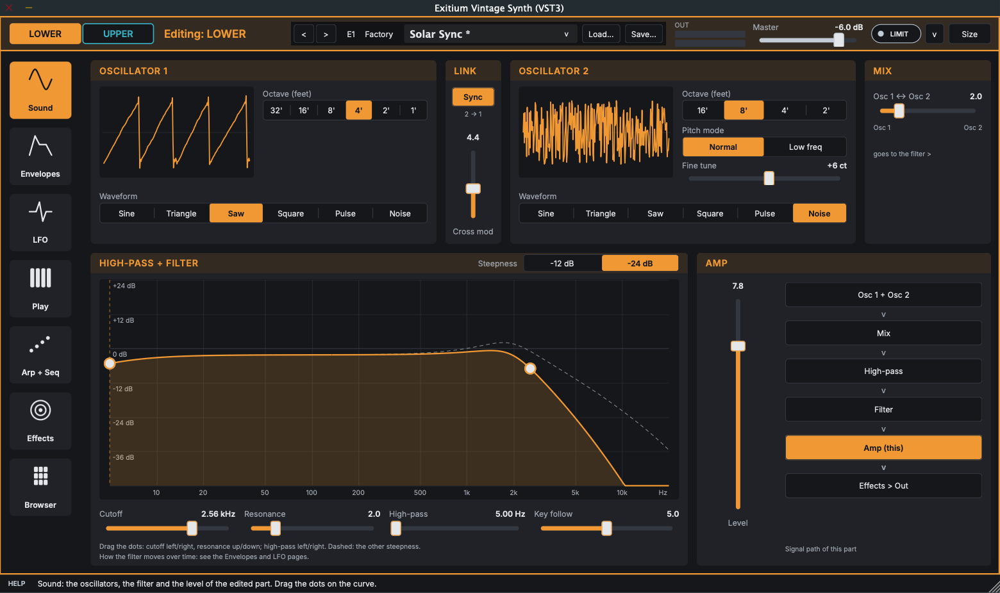

# Exitium Vintage Synth

A bi-timbral, analog-style polyphonic synthesizer instrument in VST3 format, by **Exitium**.
It's a two-oscillator subtractive synth in the style of the classic 80s flagship polys, with our own
naming and design.



More pictures of every editor page: [docs/screenshots.md](docs/screenshots.md).

> **Status: 0.9.0, a public beta, is released** ([downloads](https://github.com/romuaa/vintage-synth/releases)). The instrument is
> feature-complete: two 16-voice parts (Lower and Upper) with Whole, Dual and Split modes,
> arpeggiator and 16-step sequencer, chorus, delay and reverb, 64 factory programs with banks, and
> its own editor. A release is one unsigned zip per platform, without installers (see
> [Platforms](#platforms)). It has been tried by hand in Cubase and Reaper on macOS, Windows 11
> and Linux.
>
> This repository is also a worked example of AI-assisted development with automated testing
> and CI/CD: see [How this project is developed](#how-this-project-is-developed).

## Features

- **Two parts:** Lower and Upper, each a complete 16-voice synth. Whole (one sound), Dual (both
  layered, up to 32 voices) or Split (bass below, lead above, movable split point), with balance,
  pan per part and stereo output.

- **16 voices** with Poly, Unison (2–16 voices with detune) and Solo modes, click-free voice stealing,
  sustain pedal, portamento (always or legato), velocity to level and filter, bend range up to an
  octave, mod wheel vibrato. 32 voices use about 5 % of one CPU core at 48 kHz.

- **Two VCOs:** sine, triangle, saw, square, pulse and noise on both. VCO-1 range 32'–1', VCO-2 16'–2'.
  Hard sync (VCO-1 to VCO-2) and exponential cross-mod at audio rate. VCO-2 Lo Freq mode turns it into a
  second, sync-capable LFO. PWM from LFO, ENV-1 or manual. Pitch modulation from LFO and ENV-1.
- **Filters:** non-resonant high-pass, then a 4-pole resonant low-pass (−24 or −12 dB/oct) that
  self-oscillates. Cutoff modulation from ENV-1 or ENV-2, LFO, and keyboard follow.
- **VCA** with level and four-step LFO tremolo depth.
- **Two ADSR envelopes** with analog-style curves and keyboard-follow for times. ENV-1 can be inverted.
- **LFO:** sine, triangle, saw, square, random (sample and hold) and noise, with delayed fade-in.
- **Vintage amount:** 0 is exactly clean; turning it up adds per-voice tuning offsets, slow pitch drift,
  and filter and envelope tolerances. Deterministic, so renders repeat exactly.
- **Sound quality:** anti-aliased oscillators (measured aliasing ≤ −113 dB up to a 5 kHz fundamental),
  2× oversampling in real time and 4× when rendering offline. Latency (5 to 8 samples) is reported to the host.
- **Output:** 6 dB of fixed headroom and a soft limiter (on by default, ceiling −12 … 0 dB, no added
  latency, never above the current (smoothed) ceiling) so that heavy chords and effect settings do
  not clip.

- **Arpeggiator and 16-step sequencer** in time with the host: patterns up, down, up + down, random
  and as played over 1 to 4 octaves; steps with pitch, velocity, rest and tie; rate from 1/4 to 1/32
  with triplets, gate, swing and hold; on the Lower part, the Upper part or both.
- **Effects:** chorus (two modes), delay with ping-pong, and reverb, shared by both parts.
- **Programs and banks:** 64 factory programs in a browser with categories and search; your own
  programs, banks to import and export, and loading only the sound of one part ("tone") into
  Lower or Upper. MIDI Program Change selects programs.
- **Editor:** one page per purpose (Sound, Envelopes, LFO, Play with a playable keyboard, Arp + Seq,
  Effects, Browser), pictures drawn from the real envelope, LFO, filter and arpeggiator code, help
  text for every control, live host automation, 75 to 200 % size. See
  [docs/screenshots.md](docs/screenshots.md).

## Platforms

| OS | Architectures | Format |
|---|---|---|
| macOS 11+ | Universal (Apple silicon + Intel) | VST3 |
| Windows 10/11 | x64 and ARM64 in one bundle | VST3 |
| Linux | x86_64 and ARM64 in one bundle (glibc 2.35 or newer) | VST3 |

Download the zip for your platform from the [releases page](https://github.com/romuaa/vintage-synth/releases) (0.9.0, a public beta,
marked as a pre-release), or build from source. Until v1.0 the parameter set and the saved-state
format may still change.

A release is one zip per platform (macOS, Windows, Linux) that you unpack and copy into
your VST3 folder; there are no installers and no code signing yet. Each zip carries an `INSTALL.txt`
for its platform (folders, the unsigned-plugin warning, uninstall), the licence, a `SOURCE.txt` that
names the exact commit, and `THIRD-PARTY.txt`. The Windows ARM64 and Linux ARM64 parts of the merged
bundles are experimental: built and unit-tested, but not run through pluginval and not tuned.
How the zips are made and checked: [docs/architecture.md](docs/architecture.md) section 10 and
`scripts/package-release.sh` (`pack`, `verify`, `sums`, `selftest`); the release workflow is the
`build` workflow started by hand with `-f targets=all -f release=true`, which builds Vintage only
(`-DVS_BUILD_BSIDE=OFF`) and ends in a draft GitHub release that the owner publishes.

## Building

Requirements: CMake ≥ 3.28, a C++20 compiler (Xcode on macOS, Visual Studio 2022 or newer on Windows), and
Ninja on macOS (`brew install cmake ninja`).

```bash
git clone --recurse-submodules https://github.com/romuaa/vintage-synth.git
cd vintage-synth
# (already cloned? run: git submodule update --init --recursive)
```

**macOS (universal binary):**

```bash
cmake -S . -B build/mac -G Ninja -DCMAKE_BUILD_TYPE=Release
cmake --build build/mac --parallel
```

The plugin is at `build/mac/VintageSynth_artefacts/Release/VST3/Exitium Vintage Synth.vst3`. Copy it to
`~/Library/Audio/Plug-Ins/VST3/` to use it in a DAW.

**Two plugins.** The same build also produces **Exitium B-Side**, the second instrument (a chip synth, in
development: the plugin is still a shell around test tones while its chip model is built and tested
as a library, see the [Roadmap](#roadmap)), at
`build/mac/BSide_artefacts/Release/VST3/Exitium B-Side.vst3`. `-DVS_BUILD_BSIDE=OFF` builds only
Exitium Vintage Synth and its tests, exactly as before B-Side existed. Build one plugin with
`cmake --build build/mac --target VintageSynth_VST3` or `--target BSide_VST3`.

**Windows:**

```bat
cmake -S . -B build/win-x64 -A x64
cmake --build build/win-x64 --config Release --parallel
```

Use `-A ARM64` for Windows on ARM. Run the tests with `ctest --test-dir build/win-x64 -C Release`.
Copy the `.vst3` to `C:\Program Files\Common Files\VST3\`. CI builds both and merges them into one bundle.

**Linux (x86_64):**

```bash
sudo apt install build-essential cmake ninja-build libasound2-dev libjack-jackd2-dev ladspa-sdk \
  libfreetype-dev libfontconfig1-dev libx11-dev libxcomposite-dev libxcursor-dev libxext-dev \
  libxinerama-dev libxrandr-dev libxrender-dev libxi-dev
cmake -S . -B build -G Ninja -DCMAKE_BUILD_TYPE=Release
cmake --build build --parallel
mkdir -p ~/.vst3 && cp -r "build/VintageSynth_artefacts/Release/VST3/Exitium Vintage Synth.vst3" ~/.vst3/
```

The Linux build links the C++ runtime statically; at run time it needs glibc 2.35 or newer,
libfontconfig and libfreetype. CI builds it on Ubuntu 22.04 and load-tests the x86_64 build in
containers of several distributions (Ubuntu, Debian, Fedora, Arch). The ARM64 build is built and
tested in CI too, and locally in a container on every change; it is not performance-tuned for small boards.
The release was tried by hand in Reaper on an Arch-based distribution.

Developers on a Mac with Docker can run `scripts/linux-check.sh` before pushing: it builds and tests
with GCC in a native Linux ARM64 container (`--sanitize` for the AddressSanitizer/UBSan run).

## Try it in a plugin host

`scripts/dev-host.sh` (macOS) builds the plugin and JUCE's AudioPluginHost (about 2 minutes the first
time on Apple silicon) and opens the host with MIDI Input → Exitium Vintage Synth → Audio Output already wired.
`scripts/dev-host.sh --plugin bside` does the same for Exitium B-Side (`--plugin vintage` is the default).

- Open the editor: double-click the plugin's node ("Exitium Vintage Synth" or "Exitium B-Side").
- Play without a MIDI keyboard: the on-screen piano at the bottom of the host window (mouse, or the
  computer keys A W S E D F T G Y H U J K; Z and X shift the octave). A hardware keyboard also works.
- Audio device and buffer size: Options > Audio Settings. macOS may ask for microphone permission
  because the host opens the default input; denying is fine.
- Flags: `--build-only`, `--no-build`, `--debug`, `--wait` (stay attached to the host), and `--install` (also copies the plugin to
  `~/Library/Audio/Plug-Ins/VST3/`; the only option that writes outside the repository).
- The host keeps its settings in `~/Library/Preferences/Juce Audio Plugin Host.settings`.

What to check by hand: [docs/ui-test-checklist.md](docs/ui-test-checklist.md).

## Before you push

Run `scripts/preflight.sh --quick` while working and `scripts/preflight.sh` before you push (needs
CMake, Ninja and Docker; the first run downloads pluginval, the VST3 validator sources and a scanner
image into `~/Library/Caches/vs-preflight/`). It builds and tests both macOS universal plugins, runs
pluginval and the VST3 validator on each bundle, the sanitizers, the Linux ARM64 container build, a
security scan and repository checks (`VS_PREFLIGHT_PLUGINS=vintage` or `bside` limits pluginval and the
validator to one plugin while iterating; the hand-over run always covers both). `scripts/preflight.sh --clean` removes what it cached. Windows and Linux
x86_64 are confirmed by a manually started CI run. The `mac` step also packs the macOS release zip
from the Vintage bundle it just validated, verifies the zip and loads the unpacked bundle in a host.

## Testing

```bash
ctest --test-dir build/mac --output-on-failure        # unit tests + host smoke test
build/mac/tests/voice_bench                           # CPU cost per voice
VS_RENDER_DIR=/some/dir build/mac/tests/VintageSynthTests "[.render]"   # audition WAV + spectrogram
```

- **Unit tests** (Catch2) cover oscillator aliasing and pitch, filter cutoff, slope and self-oscillation,
  envelope and LFO timing, sample-accurate MIDI, determinism, the arpeggiator and sequencer, the
  effects, parameters and their text, presets and banks, state, and the editor (models, pictures, no
  allocation while painting, accessibility inventory).
- **Render regression** (ctest label `render`) compares rendered audio features with golden references.
- **host_smoke** loads the built `.vst3` the way a DAW does and checks identity, parameters, rendering at
  44.1/48/96 kHz and state save/restore (`host_smoke --profile vintage|bside <bundle>`; ctest runs
  `host_smoke` and `host_smoke_bside`).
- **BSideTests** (`tests/bside/`) test Exitium B-Side's shell: the skeleton contract, parameters,
  programs, state, bypass, the guard, the arpeggiator and no allocation in `processBlock`.
- **bside_unit** and **bside_trace** (ctest labels `bside`, `trace`) test the B-Side chip model as a
  library: the digital core replays the committed reference data (`tests/bside/reference/`: register
  traces with the reference emulator's digital state and audio features,
  `docs/bside-oracle-adapter.md`) without a mismatch; the rendering is held to its alias budgets.
- **pluginval** at strictness 10 and the **VST3 validator** run on each bundle in the local gate
  (macOS, with the editor tests) and in CI on macOS, Windows x64 and Linux x86_64 (without them):
  `pluginval --strictness-level 10 --validate-in-process "<path>/Exitium Vintage Synth.vst3"`.

## CI and security

- `build` workflow, **started by hand only** (verification is local-first: `scripts/preflight.sh`):
  macOS universal, Windows x64 and ARM64, Linux x86_64 and ARM64 builds with unit tests and the VST3
  host smoke test; pluginval on macOS, Windows x64 and Linux x86_64; the VST3 validator; merged
  Windows and Linux bundles; load tests of the Linux x86_64 build in several distributions; a Linux
  job that runs the tests under AddressSanitizer and UBSan. Ninja and a compiler cache keep it fast.
  With the input `release=true` (and `targets=all`) it builds Vintage only, then packs and verifies
  the release zips, loads them in a host and creates a draft release; only that last job can write
  to the repository's releases, and it never publishes.
- `security` workflow: [Trivy](https://trivy.dev) scans the repository for vulnerable dependencies,
  committed secrets and misconfigurations on every push to `main`, on pull requests and weekly.
- GitHub code scanning (CodeQL, default setup) analyses the C++, Python and workflow code on pushes
  and pull requests.
- Dependabot keeps GitHub Actions (pinned by commit SHA) and the JUCE and Catch2 submodules up to date.
- `main` is protected: changes arrive through pull requests only.

## How this project is developed

A human owner directs AI coding agents: the owner makes the product decisions and approves every
merge and release; agents write, test and review the code. Besides the instruments, the repository
is meant as a worked example of good practice in three areas:

- **AI-assisted development:** the agents' rules are files in the repository
  ([CLAUDE.md](CLAUDE.md), skills in `.claude/skills/`); interfaces are written as contracts before
  the code; every step is reviewed by an independent agent with its own test harness; decisions
  and lessons are logged.
- **Automated testing:** one local gate (`scripts/preflight.sh`) runs every check a single machine
  can run, with gates written as numbers (alias limit, CPU budget).
- **CI/CD and DevOps:** CI confirms the platforms the local gate cannot reach, a release is one
  rehearsed workflow run that ends in a draft for a person to publish, and dependencies, actions
  and runner images are pinned and scanned.

The full description, with the reason for each practice, is in
[docs/development-practices.md](docs/development-practices.md).

## Project layout

```
source/common/     shared by both instruments: dsp, engine (notes, voice allocation, mixer), fx,
                   seq (arpeggiator, sequencer), params, presets, ui (editor library), shell (the
                   shared processor skeleton)
source/vintage/    Exitium Vintage Synth: processor, dsp (oscillator, filters, envelope, LFO, drift),
                   engine (voice, part), params, ui (one file pair per editor page)
source/bside/      Exitium B-Side: processor, chip model, program engine, parameters, presets
presets/           factory programs (JSON, embedded in the plugins)
resources/         the embedded font with its licence; release text templates
tests/             unit tests, render regression, CPU benchmarks, VST3 host smoke test; tests/bside/
scripts/           the local gate (preflight.sh), Linux container check, dev host, release packer
docs/              contracts (architecture.md), decisions, engineering notes, editor help texts,
                   screenshots
external/          JUCE and Catch2 (git submodules, pinned)
```

Design choices and their reasons are in [docs/decisions.md](docs/decisions.md); lessons learned are in
[docs/engineering-notes.md](docs/engineering-notes.md); the history of changes is in [CHANGELOG.md](CHANGELOG.md).

## Roadmap

| Milestone | Scope | Status |
|---|---|---|
| M0 | Project skeleton, CI, build for all targets | Done |
| M1 | Single-part voice engine | Done |
| M2 | Polyphony: 16 voices, Poly/Unison/Solo, portamento, voice stealing, velocity, bend range | Done |
| M3 | Bi-timbral: Upper part, Whole/Dual/Split | Done |
| M4 | Arpeggiator and 16-step sequencer | Done |
| M5 | Chorus, delay and reverb | Done |
| M6 | Presets, patch banks, 64 factory programs, golden-render regression tests | Done |
| M7 | Custom UI | Done (M7a–M7f); final category colours and a top-bar redesign deferred |
| M8 | Hardening and the first release (0.9.0, a public beta: unsigned zips, no installers; signing and installers later) | Done: 0.9.0 published on 2026-11-20 |

A second instrument is in development in this repository: **Exitium B-Side**, a polyphonic synth
modelled on a classic 3-voice sound chip from early-1980s home computers, as its own plugin sharing
the common engine code (`source/bside/`, built unless `-DVS_BUILD_BSIDE=OFF`). The plugin is still a
shell with the shared parameters, programs, state, arpeggiator and effects around a placeholder
test-tone part: it makes no chip sound yet. The chip model exists as a tested library that is not
wired in. **B-Side was paused for the first release of Exitium Vintage Synth** and is not part of 0.9.0.

| B-Side step | Scope | Status |
|---|---|---|
| S1 | Plugin shell, patch tables, trace formats, tables in presets | Done |
| S2a | Chip digital core, exact against the reference per cycle | Done |
| S2b | Own combined-waveform tables (fitted, never copied); band-limited waveform rendering | Done |
| S2c | Patch program engine | Done |
| S2 rest | Render cost step, parameters | Done; Model A rendering still above its cost target; alias follow-up step done (narrow pulses, exact sync ratios) |
| S3 | Filter and output path | Started (filter in work on a branch), paused |
| S4 | Polyphony, wiring into the plugin, factory patches | Not started |

## License

Copyright © Exitium. Licensed under the **GNU Affero General Public License v3.0**; see [LICENSE](LICENSE).
Built with [JUCE](https://juce.com) (AGPLv3). Every binary release comes with its complete source code.

Third-party components: [JUCE](https://juce.com) (AGPLv3), Catch2 (BSL-1.0, tests only), the
Steinberg VST3 SDK as bundled with JUCE (MIT), and the Inter typeface embedded in the editor, which
keeps its own licence (SIL Open Font License 1.1; `resources/fonts/inter/OFL.txt`, source and
checksums in `resources/fonts/inter/SOURCE.txt`). CI uses pluginval (GPLv3), the VST3 SDK validator (MIT),
Trivy (Apache-2.0), ccache and sccache as separate tools; none of them is linked into or shipped
with the plugin.

Contributions are welcome under the same licence: see [CONTRIBUTING.md](CONTRIBUTING.md).
To report a security problem, see [SECURITY.md](SECURITY.md).

VST is a registered trademark of Steinberg Media Technologies GmbH.
