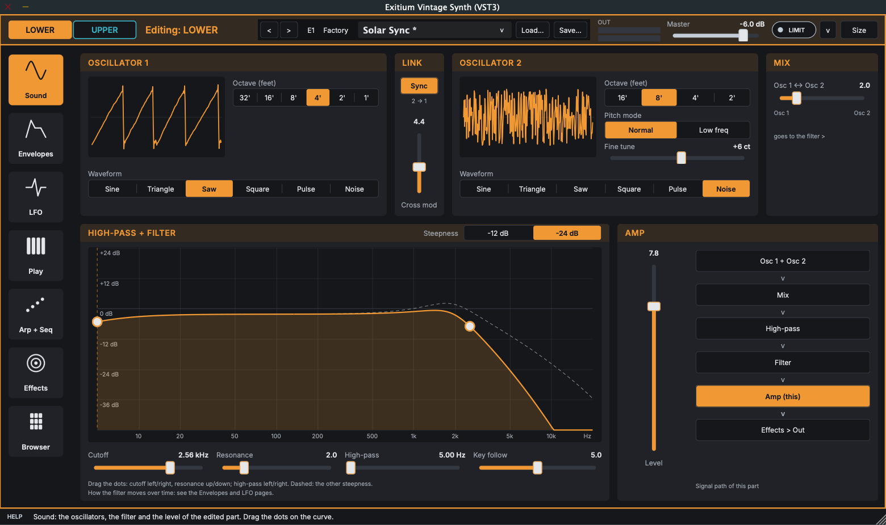
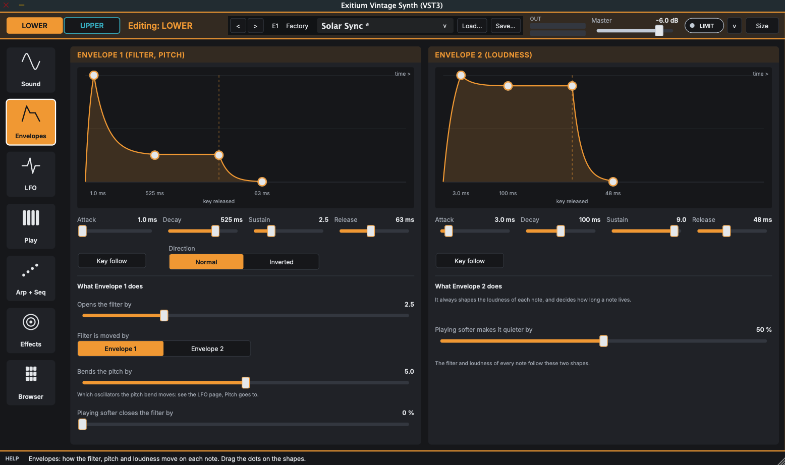
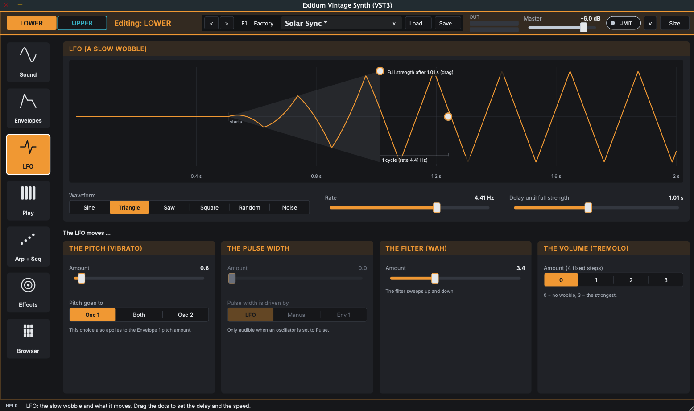
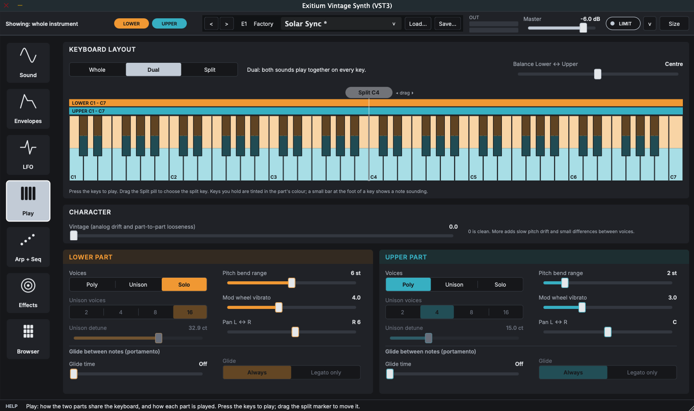
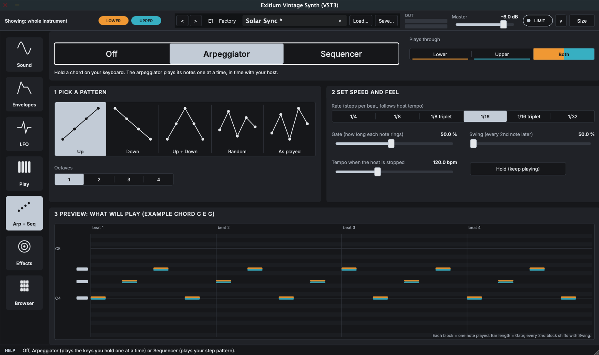
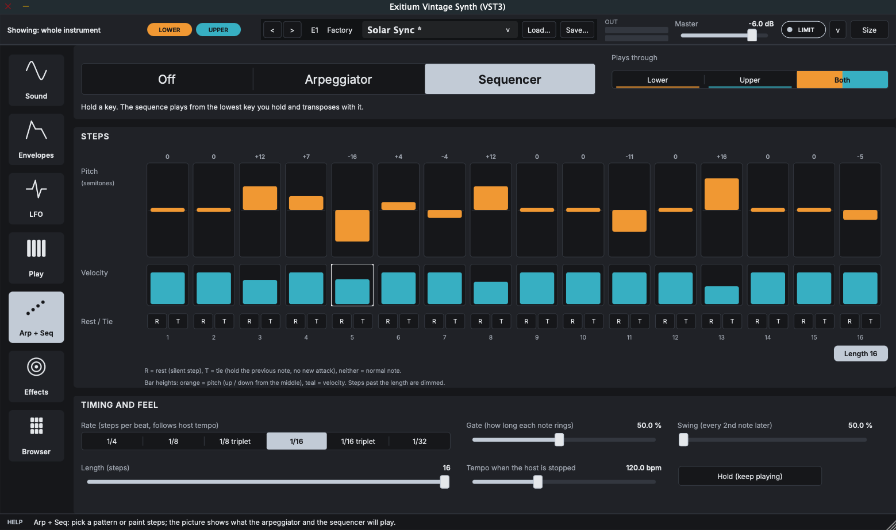
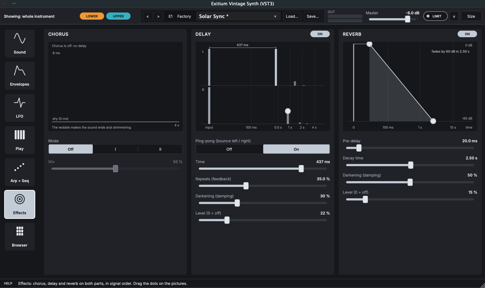
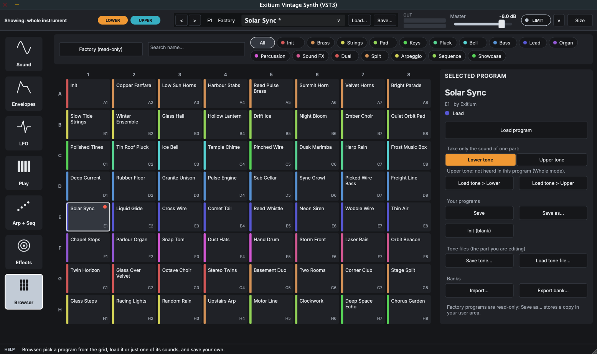

# Screenshots

The editor of Exitium Vintage Synth, one page per purpose. The pictures show the program
"Solar Sync" from the factory bank. Pictures taken on macOS at 100 % size (2026-11-19).

To hear it as well: the [demo video](https://youtu.be/IdVCa7lpVsQ), an improvisation recorded with version 0.9.0.

## Sound

Two oscillators with their live waveforms, sync and cross modulation, the mix, the high-pass and
filter curve (drag the dots), and the signal path of the edited part.

## Envelopes

Envelope 1 (filter and pitch) and Envelope 2 (loudness), drawn from the real envelope code, with
what each one does below it.

## LFO

The slow wobble with its delay, and the four things it can move: pitch, pulse width, filter and
volume.

## Play

How the Lower and Upper parts share the keyboard (Whole, Dual, Split), the Vintage amount, and
how each part is played. The keys play notes.

## Arp + Seq

The arpeggiator: pick a pattern, set speed and feel, and see what will play.

The 16-step sequencer: pitch, velocity, rests and ties per step.

## Effects

Chorus, delay and reverb, in signal order, each with a picture of what it does.

## Browser

The 64 factory programs in a grid, with categories, search, and loading the sound of one part
only.

